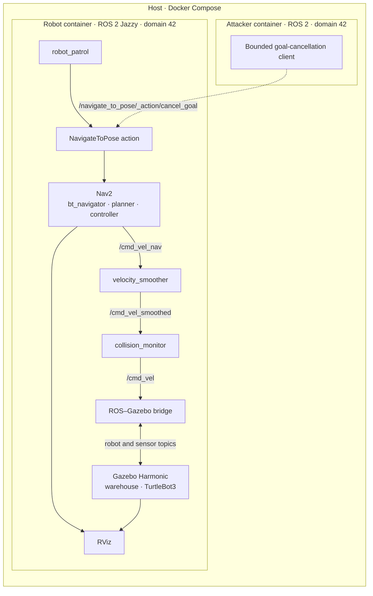

# Architecture

## System architecture



## Containers

### Robot container

Provides Gazebo Harmonic, ROS 2 Jazzy, Nav2, the warehouse assets, ROS-Gazebo bridge, RViz and the patrol workspace.

### Attacker container

Provides a separate ROS 2 Jazzy participant on domain `42`. The container has no device access, Docker socket or privileged mode. It demonstrates exposure caused by shared DDS discovery and missing action-level authorisation.

## Simulation interfaces

```text
/clock
/odom
/scan
/imu
/joint_states
/tf
/tf_static
/cmd_vel
```

## Transform tree

```text
map -> odom -> base_footprint -> base_link -> base_scan
```

AMCL publishes `map -> odom`. Gazebo/robot interfaces provide the odometry and robot-frame transforms.

## Navigation pipeline

```text
planner_server
controller_server (MPPI)
behavior_server
bt_navigator
waypoint_follower
velocity_smoother
collision_monitor
```

Command flow:

```text
/cmd_vel_nav -> /cmd_vel_smoothed -> /cmd_vel
```

## Sensor correction

The simulated GPU LiDAR minimum range is `0.25 m`. This rejects self-returns inside the approximately `0.22-0.23 m` robot footprint, preventing false Collision Monitor interventions.

## Localisation visualisation

Nav2 publishes `nav2_msgs/msg/ParticleCloud`, which standard RViz does not display as a PoseArray. The repository includes:

```text
/particle_cloud -> particle_cloud_converter -> /particle_cloud_pose_array
```

## Patrol

`robot_patrol` sends one `NavigateToPose` goal at a time, waits at each station and retries bounded failures. The route configuration is external YAML.

## Security intervention

The attacker invokes:

```text
/navigate_to_pose/_action/cancel_goal
action_msgs/srv/CancelGoal
```

A zero UUID and timestamp target all eligible goals. The intervention is bounded and does not change the velocity graph.
